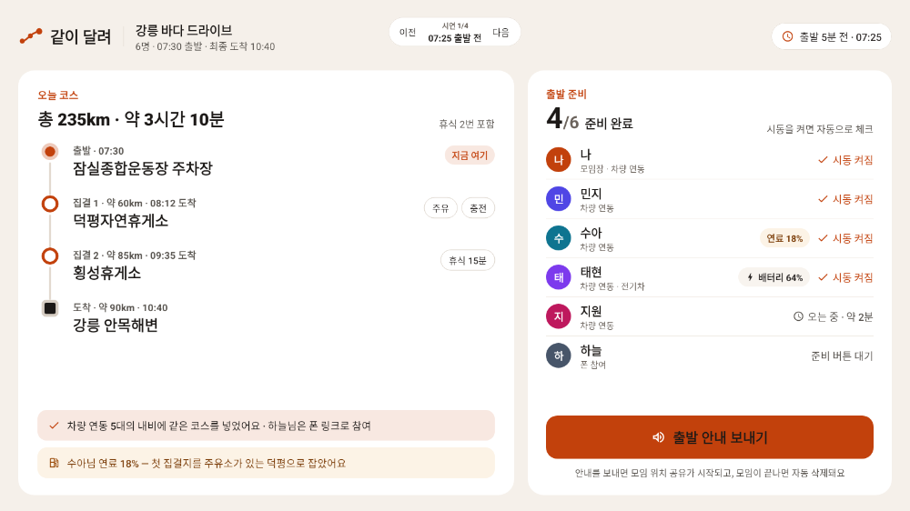
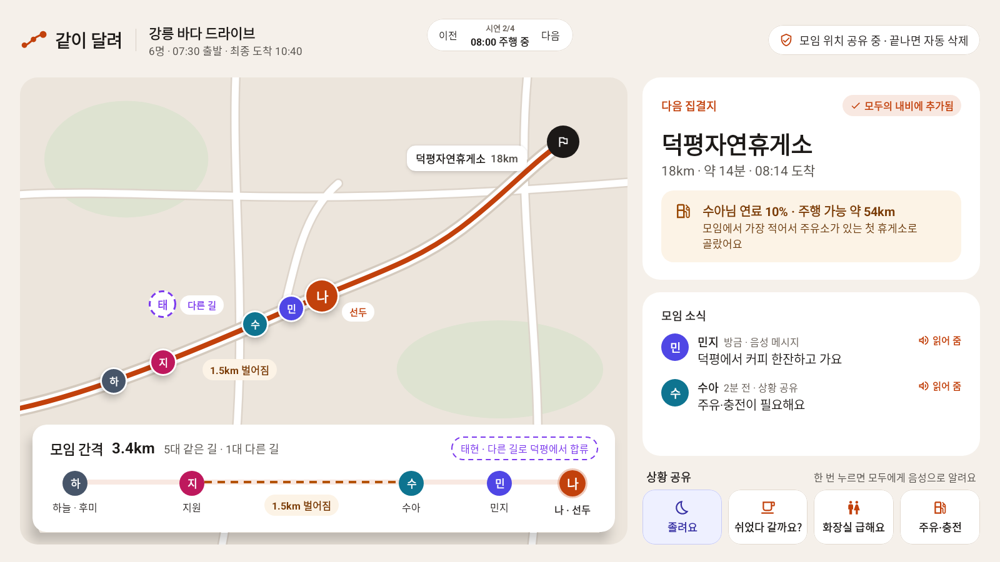
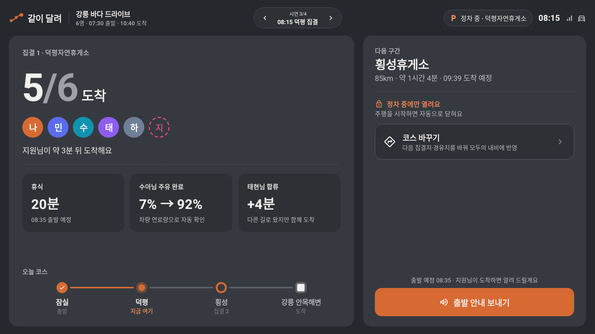
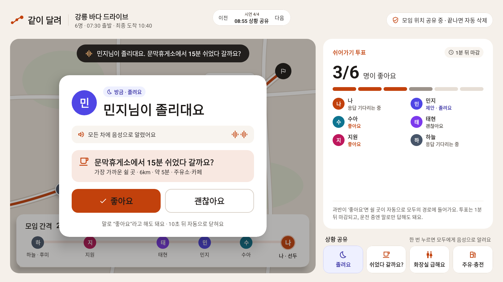
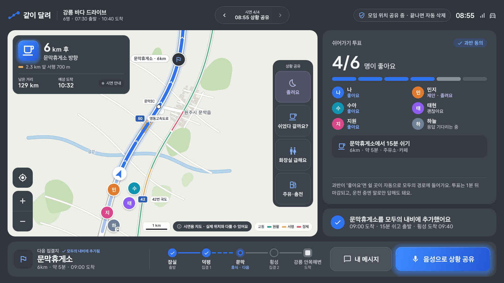
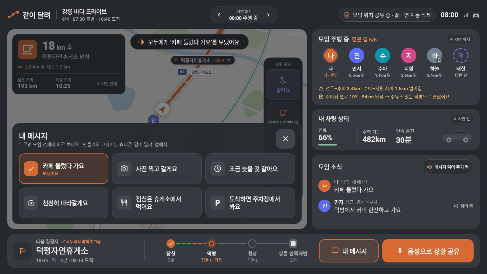
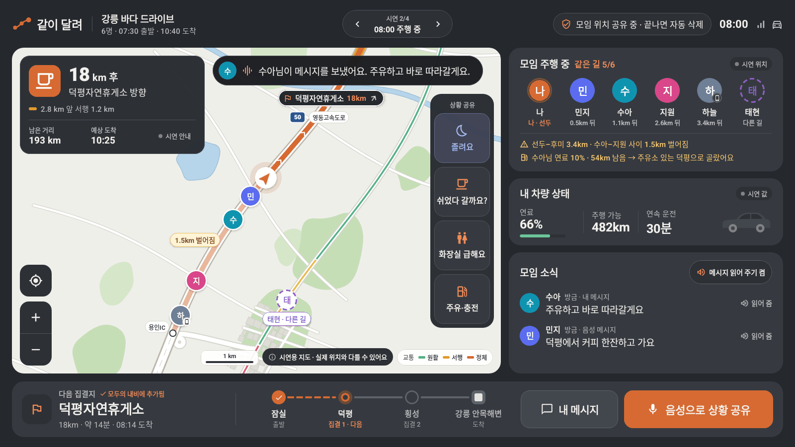
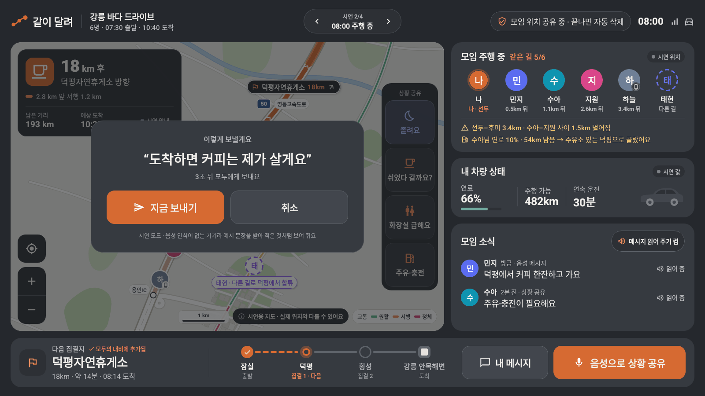

# 같이 달려 (Run Together)

**모임 드라이브 그룹 내비** — 현대자동차·기아 차량용 앱 개발 공모전(Pleos Connect) 출품작

여러 대가 함께 떠나는 날, 차량 데이터와 원터치 음성 상황 공유로 코스·집결지·휴식을 모임 전체에 맞춰
“따라가지 않아도 함께, 안전하게 도착하게” 해 주는 차량용 앱입니다.

## 화면

시나리오 A(6명, 잠실 → 강릉 안목해변) 그대로입니다. 1600×900 차량 화면 기준, CI가 실제 Compose 코드로 그린 이미지입니다.
시연 흐름 전체(41개 상태)는 `Preview frames` 워크플로가 `ci/preview-frames` 브랜치에 1600×900 원본으로 올립니다.

| ① 07:25 출발 전 | ② 08:00 주행 중 |
|---|---|
|  |  |
| **③ 08:15 집결지 도착** | **④ 08:55 상황 공유 — 민지 ‘졸려요’** |
|  |  |
| **④ 투표 통과 → 모두의 내비에 추가** | **② 내 메시지 — 큰 버튼으로 골라 바로 보내기** |
|  |  |
| **② 받은 메시지 — 보낸 사람 얼굴과 함께 읽어 줌** | **② 음성으로 상황 공유 — 받아 적은 문장 확인 후 전송** |
|  |  |

화면은 현대차그룹 SDV 인포테인먼트 Pleos Connect 에 맞춘 디지털 콘셉트입니다 (`ui/theme/Theme.kt`).
- 글꼴: Pleos Connect 시스템 글꼴 **Asta Sans** (42dot, SIL OFL 1.1 — `assets/licenses/asta_sans_OFL.txt`)
- 색: 흰 바탕(#FFFFFF · 카드 #F4F6F9 + 얇은 테두리) × 디지털 블루(#2563EB). 모든 글자는 놓이는 면 위에서 4.5:1 이상 (모바일 앱 디자인도 같은 색)
- 파랑은 로고 · 지금 고른 것 · 주요 버튼 · 내 차 위치와 경로 · 집결지 진행 · 중요한 상태에만 씁니다.
- 주요 버튼은 디지털 블루 그라데이션(#3D8BFF → #2456D6)과 은은한 바깥 빛, 앞길 경로와 내 차 둘레에도 옅은 빛. 움직이는 효과는 쓰지 않습니다.

## 지금 들어 있는 것 (v0.1)

| 화면 | 내용 |
|---|---|
| ① 출발 전 | 오늘 코스, 시동 체크인(시동을 켜면 자동 체크), 연료가 가장 적은 차에 맞춘 첫 집결지 안내, 출발 안내 음성 |
| ② 주행 중 | 지도(다음 안내 · 남은 거리 · 도착 예정, 모임 차 위치와 간격, 교통), 모임 주행 현황, 내 차량 상태(차가 주는 값만), 모임 소식(읽어 주기 켬/끔), 다음 집결지와 코스 진행, 원터치 상황 공유 4개, **내 메시지**, **음성으로 상황 공유** |
| ③ 집결지 도착 | 도착 현황, 주유 자동 확인, 오늘 코스 진행, 다음 구간, 정차 중에만 열리는 코스 바꾸기 |
| ④ 상황 공유 | “민지님이 졸리대요” 음성 알림 → 가장 가까운 쉴 곳 제안 → 쉬어가기 투표(과반·1분 마감) → 모두의 경로에 추가 |

모임 엔진(단위 테스트 포함)

- **집결지·휴식 추천**: 도달 가능성(가장 연료가 적은 차 기준 20% 여유), 연속 운전 2시간 전 휴식, ‘졸려요’ 신호, 편의시설, 도착 시각 차이
- **모임 간격**: 선두·후미 간격과 가장 많이 벌어진 구간, 다른 길로 가는 차
- **쉬어가기 투표**: 제안자 포함 과반이면 통과, 1분 뒤 마감, 과반이 불가능해지면 바로 종료
- **음성 문구**: 상황별 안내 문장, 익명 옵션, 한국어 조사(을/를, 으로/로) 처리
- **운전 중 안전 규칙**: 주행 판단(기어·속도), 알림 10초 자동 닫힘, 2시간 전 휴식 제안

## 차량 데이터 · SDK

차량(Pleos Connect)에서 실행하면 아래 SDK를 쓰고, 일반 기기에서는 시연 데이터와 안드로이드 기본 기능으로 대신합니다.

| 기능 | 쓰는 SDK·API | 앱에서 하는 일 |
|---|---|---|
| 기어·연료·배터리·주행 가능 거리·연속 운전 시간 | **Pleos Vehicle SDK** 2.3.2 | 주행/정차 화면 전환, 연료가 가장 적은 차 기준 집결지, 연속 운전 2시간 전 휴식 제안 |
| 시동·속도 | AAOS `CarPropertyManager` | 시동 체크인, 주행 판단 (차종별 지원 여부 확인 후 구독) |
| 경로·경유지 | **Pleos NaviHelper SDK** 3.0.5 | 모임 코스를 모두의 내비에 넣고, 투표가 통과되면 쉴 곳을 첫 경유지로 추가 |
| 길 안내 값 | **Pleos NaviHelper SDK** 3.0.5 | 다음 안내(TBT) · 목적지/경유지 남은 거리·시간 · 현재 위치·방향 · 경로 교통을 주행 화면에 (없으면 ‘시연 안내’) |
| 지도 | 시연용 그림 지도 (`ui/map/MockNavMap.kt`) | NaviHelper 는 지도를 그려 주지 않아 `GroupMapRenderer` 뒤에 두었고, 실제 지도 SDK 로 바꿔 끼울 수 있음. 화면에 ‘시연용 지도’ 표시 |
| 음성 안내 | **Pleos TextToSpeech SDK** 3.3.1 (실패 시 Android TTS) | “민지님이 졸리대요” 같은 상황 공유를 모든 차에서 읽어 줌 + 화면 자막. `VoiceQueue` 가 한 번에 하나 · 안전 안내 먼저 · 내비 길 안내 중에는 대기 |
| 말로 답하기 · 음성 공유 | **Pleos SpeechToText SDK** 3.3.1 | 투표에 “좋아요 / 괜찮아요”로 답하기, ‘음성으로 상황 공유’ 받아 적기 (일반 기기에서는 예시 문장으로 시연) |
| 위치 | 시연 데이터 | 다음 단계: Pleos Fused Location SDK, 휴대폰 참여자는 휴대폰 GPS |
| 다른 차와 동기화 | 시연 시뮬레이션 (`GroupChannel`) | 기본 상황 공유 · 내 메시지 · 음성 메시지가 같은 통로. 다음 단계: 동기화 서버(WebSocket) |
| 내 메시지 목록 | 시연 데이터 (`MyMessageRepository`) | 휴대폰 앱에서 만들고 계정에 저장 → 차량 앱은 받아서 고르기만. 설계: [docs/my-messages.md](docs/my-messages.md) |

Pleos SDK 저장소(`nexus-playground.pleos.ai`)는 `settings.gradle.kts`에 넣어 두었습니다.
SDK 리스너는 `data/pleos/PleosBridge.java`에서 감싸 SDK 버전 변화에 덜 민감하게 했습니다.
`Pleos SDK probe` 워크플로는 공개 SDK의 실제 함수 목록을 `ci/sdk-probe` 브랜치에 정리합니다.

## 실행

- Android Studio, JDK 17
- **Pleos Connect Emulator(AVD)** 에서 실행하면 실제 차량 데이터를 씁니다. 에뮬레이터 차량 데이터의 기어·속도를 바꾸면 화면이 자동으로 넘어갑니다.
- 일반 에뮬레이터·태블릿에서는 **시연 모드**로 열립니다. 위쪽 ‘이전 / 다음’으로 시나리오 A를 넘깁니다.
  - 07:25 출발 전 → 08:00 주행 중 → 08:15 덕평 집결 → 08:55 상황 공유(민지 ‘졸려요’ → 투표)
- 빌드: `./gradlew assembleDebug` · 테스트: `./gradlew testDebugUnitTest`
- 화면 이미지: `./gradlew recordPaparazziDebug` (에뮬레이터 없이 JVM에서 그림). `Screenshots` 워크플로가 `ci/screenshots` 브랜치에 최신 이미지를 올립니다.

## APK 받기

- `main`에 올라갈 때마다 GitHub Actions가 테스트를 돌리고 디버그 APK를 만듭니다 (Actions → 실행 기록 → Artifacts).
- `v`로 시작하는 태그(예: `v0.1.0`)를 붙이면 Releases에 APK가 올라갑니다.

## 구조

```
app/src/main/java/com/runtogether/
  domain/   모임 엔진 (안드로이드 의존 없음, 단위 테스트)
  data/     차량 데이터 · 음성 · 내비 연결부
  demo/     시나리오 A 시연 데이터
  state/    화면 상태와 상태 전이 (투표 통과·부결 → 코스 갱신), 시연 길 안내
  ui/       Compose 화면 (시안 1600×900 비율 유지, 한국어 어절 단위 줄바꿈)
    theme/  디자인 토큰 (색 · 글자 단계 · 간격)
    map/    지도 그리기 창구(GroupMapRenderer)와 시연용 지도
```

## 안전·개인정보 원칙

- 주행 중에는 큰 버튼 한 번, 음성 우선, 글자 입력 없음 (NHTSA 운전자 주의 분산 가이드라인: 한 번에 시선 2초, 한 작업 총 12초)
- 따라잡기 안내 대신 “다음 집결지에서 만나요” (도로교통법 제46조 공동위험행위 방지)
- 위치는 모임 중에만 참여자끼리 공유하고, 모임이 끝나면 자동 삭제
